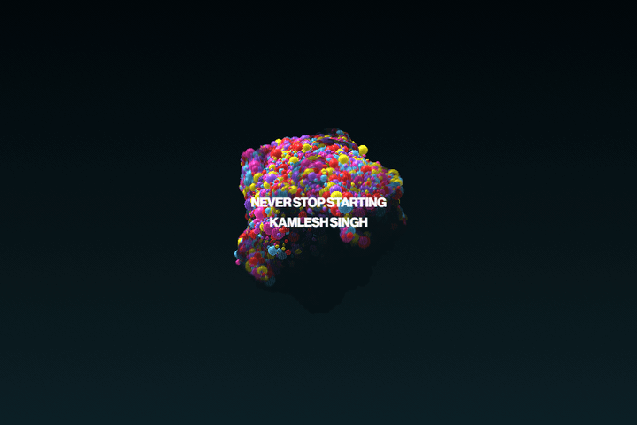
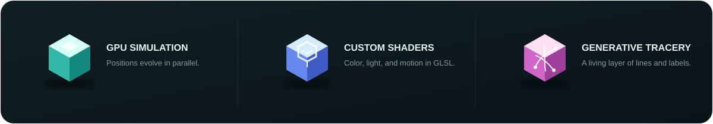

<div align="center">
  

  <br />

  <p><strong>A little universe, built one particle at a time.</strong><br />
  A real-time WebGL experiment in motion, color, and computational geometry.</p>

  <p>
    
    
    
  </p>
</div>

## In motion

This short screen recording shows the particle simulation running in the browser. The scene is rendered live with Three.js and custom shaders.

<div align="center">
  
</div>

## Inside the scene

<div align="center">
  
</div>

- **262,144 animated particles** — particle positions evolve on the GPU with a curl-noise simulation.
- **Custom shader rendering** — GLSL shaders shape, shade, and color the particles in real time.
- **Generative tracery** — drifting coordinate labels and dashed connections add a subtle data-visualization layer.
- **Motion blur and lighting** — post-processing, shadows, and environment lighting give the scene depth.
- **Responsive canvas** — the camera and rendering adapt to the browser viewport.

## Run it locally

You’ll need [Node.js](https://nodejs.org/) and npm.

```bash
npm install
npm run dev
```

Open the local URL printed by Vite. To create a production build:

```bash
npm run build
npm run preview
```

## Built with

| Tool | Role |
| --- | --- |
| [Three.js](https://threejs.org/) | 3D scene, renderer, and GPU computation |
| [GLSL](https://www.khronos.org/opengl/wiki/OpenGL_Shading_Language) | Particle simulation and rendering shaders |
| [Vite](https://vite.dev/) | Local development and production build |
| [Tailwind CSS](https://tailwindcss.com/) | Base styling |

<div align="center">
  <br />
  <sub>Made with curiosity by <strong>Kamlesh Singh Kotwal</strong></sub>
</div>
